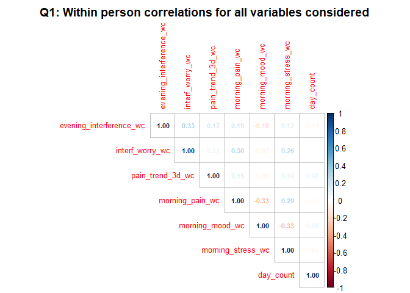
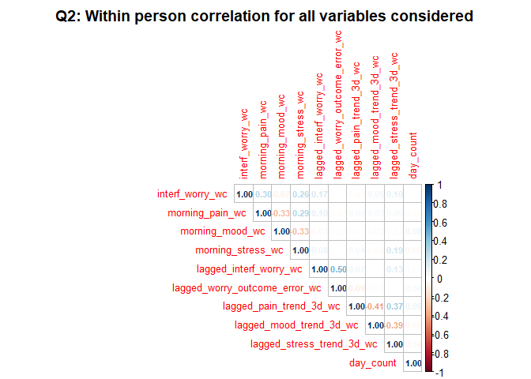
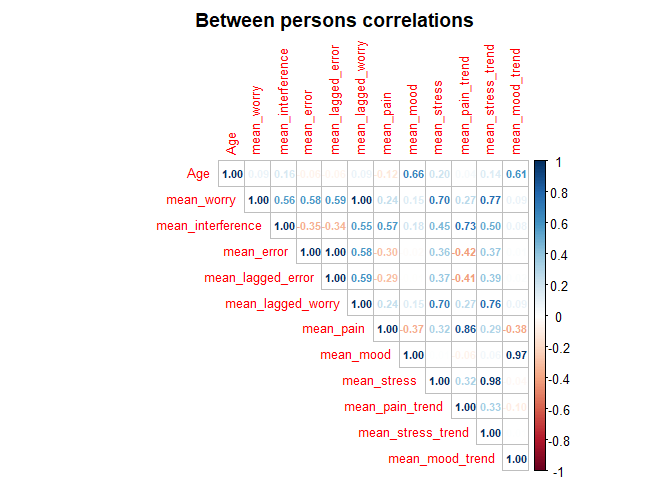

Supplementary Material: Derived Variables
================
Diego Vitali, Raffaele Buono, Tao Bi, Tony Pickering, Chris Eccleston,
Edmund Keogh, Nadia Bianchi-Berthouze, Amanda C de C Williams
2026-02-07

- [Summary & Logic](#summary--logic)
  - [Imputation variance across key
    variables](#imputation-variance-across-key-variables)
  - [Correlations](#correlations)
    - [Within-person Correlations](#within-person-correlations)
    - [Between-person Correlations](#between-person-correlations)

# Summary & Logic

This documentation describe the construction of all derived variables
used in our analyses of daily pain interference predictions. These
variables capture temporal trends, deviations from trends, and
prediction errors that we use in our models testing Bayesian learning
processes in chronic pain. All derived variables are calculated within
each of the 28 imputed datasets to propagate uncertainty from the
imputation process into subsequent analyses.

All derived variable preseve temporal ordering: all predictors use
information only from past days (lagged variables) to preserve the
causal chain of events.

When calculating our 3-days rolling means we applied an “adaptive
fallback logic” to handle early study days (e.g. Day 0, 1) when fewer
observations are available. This choice is pragramtic and allows early
study days to use shorter time windows to calculate rolling means rather
than discarding observations. We consider this a “graceful” degradation
strategy that maximise the information available in the face of this
structural missingness in the rolling mean term.

We also respected the multilevel structure of the data: where relevant
variables are calculated separately for each participant to prevent
cross-participant contamination (rolling means are calculated withing
parcitipants). Finally, we respected the structure of the MIDS (multiply
imputed dataset) object and calculation are executed within each
dataset. This is critical to preseve the MIDS structure that is required
for Rubin’s pooling rules.

\#Methods

Derived variables were calculated on the multiply imputed day-level
dataset (imp_1) containing:

- 28 imputed datasets (m = 28)
- Daily assessments nested within participants
- Complete cases for demographics (Age, Sex, Education)
- Imputed values for morning assessments (worry, pain, mood, stress) and
  evening interference

\##Generate derived predictors in all imputed datasets for pain and mood
trends

## Imputation variance across key variables

Here we use Rubin’s pooling formulas to examine the distributions of our
variable across imputations. These are not inferential estimates of
population parameters, we are assessing the weight of the variance
increased by our imputation

Rubin ([1987](https://doi.org/10.1002/bimj.4710310118)) uses the
fraction of missing information, $\lambda$, to define the severity of
missing data.

$$\lambda = \frac{(1 + \frac{1}{m})B}{T}$$

where $m$ is the number of imputations, $B$ is the between-imputation
variance (the variance of the 28 means), and $T$ is the total variance
combining within- and between-imputation components. and shows it can be
interpreted as the proportion of total variance attributable to
missingness; later summaries make this explicit.

As $\lambda$ ration gets smaller (e.g \< 0.10) we can say that
imputation adds minimal uncertainty beyond the observed sample
variability. As $\lambda$ increases (e.g. 0.10–0.30), imputation becomes
a detectable contributor to the overal variance. As $\lambda$ exceeds
.30 we can state that impact of missing data is substantial and that
between-imputation variance is not a small nor negligible contributor to
the overall variance $T$.

``` r
# Summary variables
vars <- c("evening_interference", 
          "interf_worry", 
          "worry_outcome_error",
          "morning_mood", "morning_stress", "morning_pain", 
          "pain_deviation_from_trend")

# Extract stats from all imputations
imp_stats <- map_dfr(1:imp_1_with_trends$m, function(i) {
  dat <- complete(imp_1_with_trends, i)
  dat %>%
    summarise(
      imputation = i,
      across(all_of(vars), 
             list(mean = ~mean(.x, na.rm = TRUE), 
                  sd = ~sd(.x, na.rm = TRUE)), 
             .names = "{.col}_{.fn}")
    )
})


rubins_results <- tibble(variable = vars) %>%
  mutate(
    # Extract vectors of imputation-specific statistics
    mean_vec = map(variable, ~imp_stats[[paste0(.x, "_mean")]]), # this is the vector of the sample means
    sd_vec = map(variable, ~imp_stats[[paste0(.x, "_sd")]]),     # this is the vector of the sample SDs
    
    # Rubin's rules calculations
    M = nrow(imp_stats),                                      # Number of imputations (28)
    Q_mean = map_dbl(mean_vec, ~mean(.x, na.rm = TRUE)),      # Pooled mean across all 28 imputations
    vars_within = map_dbl(sd_vec, ~mean(.x^2, na.rm = TRUE)), # Average within-imputation variance  (mean of SD^2)
    B = map_dbl(mean_vec, ~var(.x, na.rm = TRUE)),            # variance of the 28 imputation-specific mean  
                                                             
                                                              # https://pmc.ncbi.nlm.nih.gov/articles/PMC3701793/
    total_var = vars_within + (1 + 1/M) * B,                  # Total = variance combining both within- and between- 
    pooled_se = sqrt(total_var),                              # Pooled standard deviation (this is descriptive SE, 
                                                              #   not an inferential SE for mean estimates)
    lambda = (B + B/M) / total_var,                            # Proportion of total variance attributable to imputation
                                                              #   uncertainty rather than sampling variability.
    `lambda %` = round(lambda *100,2)
    
  ) %>%
  select(variable, Q_mean, pooled_se, vars_within, B, M, lambda, `lambda %`) %>%
  mutate(across(c(Q_mean, pooled_se, vars_within, B, lambda), ~round(.x, 3)))

kable(rubins_results)
```

| variable | Q_mean | pooled_se | vars_within | B | M | lambda | lambda % |
|:---|---:|---:|---:|---:|---:|---:|---:|
| evening_interference | 4.509 | 2.238 | 5.009 | 0.000 | 28 | 0 | 0.01 |
| interf_worry | 3.943 | 2.156 | 4.648 | 0.001 | 28 | 0 | 0.02 |
| worry_outcome_error | -0.566 | 2.321 | 5.387 | 0.001 | 28 | 0 | 0.02 |
| morning_mood | 5.544 | 1.833 | 3.358 | 0.000 | 28 | 0 | 0.01 |
| morning_stress | 3.241 | 2.262 | 5.117 | 0.001 | 28 | 0 | 0.01 |
| morning_pain | 3.767 | 2.493 | 6.215 | 0.001 | 28 | 0 | 0.01 |
| pain_deviation_from_trend | -0.174 | 2.110 | 4.454 | 0.000 | 28 | 0 | 0.01 |

Between-imputation variance is 0.02% of within-imputation variance. This
suggests that the random variation (error) injected by the Monte Carlo
imputation algorithm is negligible and contributes almost nothing to the
uncertainty of the descriptive statistics above.

## Correlations

Here we separate within- and between-Person Correlations. This is
because multilevel data often violates the (ergodicity) assumption that
between person patterns are equal to within person patterns.

For example: \* between-person: People with chronically higher pain may
have chronically higher worry (stable trait) \* Within-person: On days
when someone’s pain spikes above their personal average, worry could
increase proportionally to this spike.

To isolate within-person day-to-day associations, we person-mean center
all variables. After centering, correlations reflect only how daily
fluctuations co-vary within individuals.

### Within-person Correlations

``` r
library(lme4)
model_data<-complete(imp_1_with_trends, 1) %>% filter(day_count > 0) # filter out day_count = 0 (first day of data collection))

# Within person Correlations (here we look at stable difference between ppl)

    # we center variables using within person mean
    # this is because we are doing a multilevel analysis and in this dataset
    # variables vary between-person and within person.
    # Raw correlations between variables assume "Ergodicity":
    # (between-person pattern = within person pattern), which is most likely untenable.
    # 
    # Considering that we are interested in within-person correlations between key 
    # variables we do not want between person differences to inflate or dilute 
    # the within-person day-to-day correlation estimate.
    # 

# Q1 correlation matrix
q1_vars <- model_data %>%
  select(
    evening_interference,
    interf_worry,
    pain_trend_3d,
    morning_pain,
    morning_mood,
    morning_stress
  ) %>% colnames

q1_vars_centered <- model_data %>%
  group_by(alias) %>%
  mutate(
    # By centering the variables (_wc) we remove between person variance leaving only
    # within-person variance.
    across(all_of(q1_vars), ~ . - mean(., na.rm = TRUE),  .names = "{.col}_wc"
    )
  ) %>%
  ungroup()

# Correlation of within-person deviations
cor_q1 <- q1_vars_centered %>%
  select(ends_with("_wc"), day_count) %>%
  cor(use = "pairwise.complete.obs")

#round(cor_q1, 3)

# Q2 correlation matrix
# Person-mean center all variables
q2_vars <- model_data %>%
  select(
    interf_worry, 
    morning_pain, 
    morning_mood, 
    morning_stress,
    lagged_interf_worry, 
    lagged_worry_outcome_error,
    lagged_pain_trend_3d, 
    lagged_mood_trend_3d, 
    lagged_stress_trend_3d
  ) %>% colnames

q2_vars_centered <- model_data %>%
  group_by(alias) %>%
  mutate(
    across(all_of(q2_vars), ~ . - mean(., na.rm = TRUE),  .names = "{.col}_wc"
    )
  ) %>%
  ungroup()

# Correlation of within-person deviations
cor_q2 <- q2_vars_centered %>%
  select(ends_with("_wc"), day_count) %>%
  cor(use = "pairwise.complete.obs")

#round(cor_q2, 3)


library(corrplot)

# Q1
corrplot(cor_q1, method = "number", type = "upper", 
         title = "Q1: Within person correlations for all variables considered",
         tl.cex = 0.8, number.cex = 0.7,
         mar = c(0,0,2,0))
```

<!-- -->

``` r
# Q2
corrplot(cor_q2, method = "number", type = "upper",
         title = "Q2: Within person correlation for all variables considered",
         tl.cex = 0.8, number.cex = 0.7,
         mar = c(0,0,2,0))
```

<!-- -->

### Between-person Correlations

``` r
# Create person-level dataset
btw_person <- model_data %>%
  group_by(alias) %>%
  summarize(
    Age = first(Age),  # Constant within person
    mean_worry = mean(interf_worry, na.rm = TRUE),
    mean_pain = mean(morning_pain, na.rm = TRUE),
    mean_mood = mean(morning_mood, na.rm = TRUE),
    mean_stress = mean(morning_stress, na.rm = TRUE),
    mean_interference = mean(evening_interference, na.rm = TRUE),
    # Q2 additional variables
    mean_error = mean(worry_outcome_error, na.rm = TRUE),  
    mean_lagged_error = mean(lagged_worry_outcome_error, na.rm = TRUE),
    mean_lagged_worry = mean(lagged_interf_worry, na.rm = TRUE),
    
    # Confounders
    mean_pain_trend = mean(pain_trend_3d, na.rm = TRUE),
    mean_stress_trend = mean(stress_trend_3d, na.rm = TRUE),
    mean_mood_trend = mean(mood_trend_3d, na.rm = TRUE),
  ) %>% ungroup()

# Correlation between-person (here we look at stable difference between ppl)
cor_between <- btw_person %>%
  select(Age, 
         mean_worry,
         mean_interference,
         mean_error,
         mean_lagged_error,
         mean_lagged_worry,
         mean_pain, mean_mood, mean_stress, 
         mean_pain_trend,mean_stress_trend,mean_mood_trend
         ) %>%
  cor(use = "pairwise.complete.obs")

#round(cor_between, 3)

# Between persons plot
corrplot(cor_between, method = "number", type = "upper",
         title = "Between persons correlations",
         tl.cex = 0.8, number.cex = 0.7,
         mar = c(0,0,2,0))
```

<!-- -->
