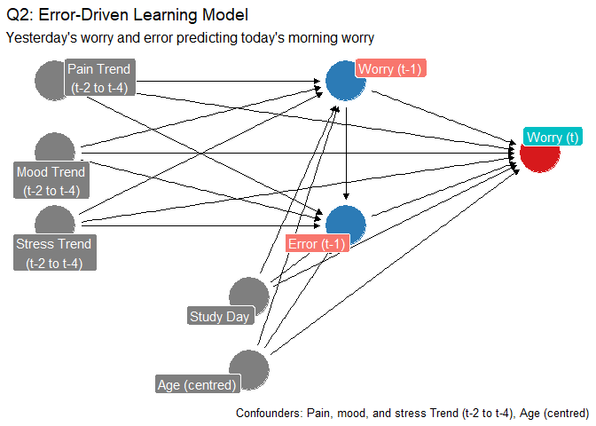
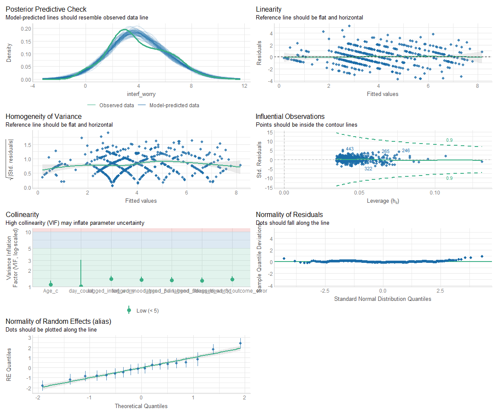
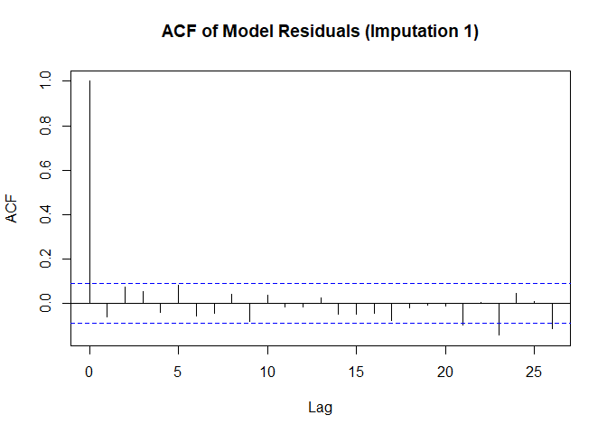
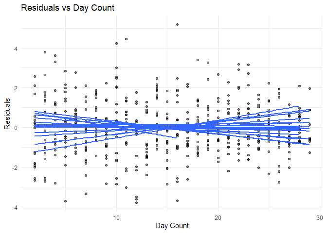
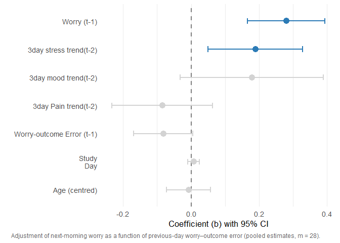

Supplementary Material: Q2 coupling model
================
Diego Vitali, Raffaele Buono, Tao Bi, Tony Pickering, Chris Eccleston,
Edmund Keogh, Nadia Bianchi-Berthouze, Amanda C de C Williams
2026-02-07

- [Summary & Logic](#summary--logic)
- [Q2: Error-Driven Learning Model](#q2-error-driven-learning-model)
  - [DAG](#dag)
  - [Model Specifications and
    Comparisons](#model-specifications-and-comparisons)
    - [Model Selection: Trends vs. Lagged Current
      States](#model-selection-trends-vs-lagged-current-states)
    - [Extended Model: Adding Recent
      Deviations](#extended-model-adding-recent-deviations)
    - [MAR-based sensitivity analysis](#mar-based-sensitivity-analysis)
  - [Multicollinearity (pooled)](#multicollinearity-pooled)
  - [Pooled Parameter Estimates](#pooled-parameter-estimates)
  - [Variance Explained (Pooled)](#variance-explained-pooled)
    - [Additional Diagnostics](#additional-diagnostics)
  - [Coefficient Visualization](#coefficient-visualization)

# Summary & Logic

This document presents the statistical models testing Question 2:
Error-driven learning. We examine whether individuals adjust their daily
interference predictions based on previous prediction errors, using a
Bayesian learning framework where yesterday’s prediction error (worry
minus actual interference) should influence today’s worry after
controlling for persistence and affective confounders.

The analysis uses multiply imputed data (m=28 imputations) with linear
mixed-effects models accounting for repeated daily assessments nested
within participants.

All models use Rubin’s pooling rules to combine estimates across
imputations, thereby accounting for missing data uncertainty in
parameter estimates, standard errors, and significance tests.

# Q2: Error-Driven Learning Model

We tested whether participants adjust their future interference
predictions in response to their prior worry–outcome errors. This tests
a core prediction of Bayesian learning models: that prediction errors
should drive updates to future predictions.

For each person and day, the worry–outcome error was defined as
*lagged_worry_outcome_error* where worry-outcome error is expressed as:

    worry_outcome_error = worry - actual # (+ = overshoot, negative = undershoot)

The primary outcome was morning worry about interference: the level of
worry about interference scored by participants in the morning.

Our main predictor was the 1‑day lagged worry–outcome error,
worry_outcome_error\[t-1\], with positive values reflecting over‑worry
on the previous day. We adjusted for 3‑day pain trend and deviations
from that trend, morning mood and stress, linear time (day_count), and
Age (centred). We estimated a linear mixed model with random intercepts
for participants:

$$interf\_worry_{it}= \beta_0 + \phi\,\text{interf\_worry}_{i,t-1} + \alpha\ \text{worry\_outcome\_error}_{i,t-1} + \beta^\top X_{it} + u_{0i} + \varepsilon_{it}$$
where:

- $\phi$ = autoregressive persistence coefficient (yesterday’s worry →
  today’s worry)
- $\alpha$ = error-driven learning coefficient (yesterday’s error →
  today’s worry)
- $X$ = control variables (pain/mood/stress trends, age, study day)
- $u_{0i}$ = person-specific random intercept
- $\varepsilon_{it}$ = within-person residual

This model allows for autoregressive persistence/decay ($\phi$) and asks
whether overworry or underworry have any incremental effect on today’s
worry level beyond yesterday’s worry and covariates. Because lagged
worry and prediction error are statistically entangled, this
specification is expected to be conservative: part of the
learning‑consistent structure could be absorbed by the lag term,
attenuating $\alpha$.

We will explore the effect of this with a simulation study.

## DAG

The directed acyclic graph (DAG) shows our assumed causal structure.
Yesterday’s worry ($t-1$) and yesterday’s prediction error ($t-1$) both
predict today’s worry ($t$), controlling for recent affective trends
(pain/mood/stress averaged over $t-2$ to $t-4$) and background
covariates (age, study day). The critical question is whether the error
term ($\alpha$) shows evidence of learning beyond simple persistence
($\phi$).

``` r
# Create the DAG
dag_Q2 <- dagify(
  Worry_t ~ Worry_t1 + Error + Pain + Mood + Stress + Age_c + Day,
  Worry_t1 ~ Pain + Mood + Stress + Age_c + Day,
  Error ~ Worry_t1 + Pain + Mood + Stress + Age_c + Day,
  
  exposure = c("Worry_t1", "Error"),
  outcome = "Worry_t",
  
  labels = c(
    Worry_t = "Worry (t)",
    Worry_t1 = "Worry (t-1)",
    Error = "Error (t-1)",
    Pain = "Pain Trend\n(t-2 to t-4)",
    Mood = "Mood Trend\n(t-2 to t-4)",
    Stress = "Stress Trend\n(t-2 to t-4)",
    Age_c = "Age (centred)",
    Day = "Study Day"
  ),
  
  coords = list(
    x = c(Worry_t = 3, Worry_t1 = 2, Error = 2, 
          Pain = 0.5, Mood = 0.5, Stress = 0.5,
          Age_c = 1.5, Day = 1.5),
    y = c(Worry_t = 0, Worry_t1 = 0.5, Error = -0.5,
          Pain = 0.5, Mood = 0, Stress = -0.5,
          Age_c = -1.5, Day = -1)
  )
)

# Plot
ggdag_Q2_bw<-ggdag(dag_Q2, text = FALSE, use_labels = "label") +
  theme_dag() +
  labs(title = "Q2: Error-Driven Learning Model",
       subtitle = "Yesterday's worry and error predicting today's morning worry",
       caption = "Confounders: Pain, mood, and stress Trend (t-2 to t-4), Age (centred)") +
    theme_dag_blank() 

ggdag_Q2<-ggdag_status(dag_Q2, text = FALSE, use_labels = "label") +
  scale_color_manual(
    values = c("exposure" = "#2C7BB6", "outcome" = "#D7191C", "latent" = "gray70"),
    guide = "none"
  ) +
  theme_dag_blank() +
  labs(title = "Q2: Error-Driven Learning Model",
       subtitle = "Yesterday's worry and error predicting today's morning worry",
       caption = "Confounders: Pain, mood, and stress Trend (t-2 to t-4), Age (centred)")

ggdag_Q2
```

<!-- -->

The baseline model in the DAG tests

## Model Specifications and Comparisons

We fit three primary models and one MAR-based sensitivity analysis.

Primary models: \* **Model 0 (Baseline)**: Tests error-driven learning
controlling for persistence (lagged worry) and lagged affective trends
(3-day pain/mood/stress trends) \* **Model 0a (Lagged current
alternative)**: Substitutes lagged current affective states (lagged
morning pain/mood/stress) for 3-day trends to test specification
sensitivity

Extended model: \* **Model 1 (Recent deviations)**: Extends Model 0 by
adding lagged deviations from trends to test whether recent acute
fluctuations (beyond stable trends) affect worry updating

Sensitivity analysis: \* **MAR-informed imputation**: Compares results
using two imputation strategies (with/without lagged worry as imputation
predictor) to assess robustness to MAR patterns - see imputation
supplementary material.

All models are pooled using Rubin´s Rules. RR are designed to pool
parameter estimates, such as mean differences, regression coefficients,
standard errors and to derive confidence intervals and p-values.

See: - [Rubin’s
rules](https://bookdown.org/mwheymans/bookmi/rubins-rules.html) -
[Rubin’s rules - significance
testing](https://bookdown.org/mwheymans/bookmi/rubins-rules.html#significance-testing)

``` r
# Model 0: Baseline with 3-day affective trends (t-2 to t-4)
model_learning_0_pooled <- with(imp_1_with_trends, 
                   lmer(interf_worry ~
                       ########### Learning terms     
                       lagged_interf_worry +           # Yesterday's worry (persistence)
                       lagged_worry_outcome_error +    # Yesterday's prediction error (learning signal)
                       ############ Confounders: lagged trends
                       lagged_pain_trend_3d +     # 3-day pain trend (t-2 to t-4)
                       lagged_mood_trend_3d +     # 3-day mood trend (t-2 to t-4)
                       lagged_stress_trend_3d +   # 3-day stress trend (t-2 to t-4)
                       day_count + Age_c + 
                       ############ Random effects
                       (1|alias)))

# Model 0a: Alternative using lagged current values instead of trends
# Tests whether recent single-day values or 3-day trends better control for affective context
model_learning_0a_pooled <- with(imp_1_with_trends, 
                   lmer(interf_worry ~ 
                       ########### Learning terms     
                       lagged_interf_worry +           # Yesterday's worry
                       lagged_worry_outcome_error +    # Yesterday's prediction error
                       ############ Confounders: lagged current states
                       lag(morning_pain) +        # Yesterday's morning pain
                       lag(morning_mood) +        # Yesterday's morning mood
                       lag(morning_stress) +      # Yesterday's morning stress
                       day_count + Age_c + 
                       ############ Random effects
                       (1|alias)))
```

### Model Selection: Trends vs. Lagged Current States

We compare Model 0 (3-day affective trends) against Model 0a (lagged
current affective states) using information criteria to determine which
specification better captures the affective contribution to worry
updating.

Lower AIC/BIC values indicate better model fit after penalizing for
model complexity. A difference of \>2 points suggests meaningful
preference.

``` r
# Calculate AIC and BIC averaged across the 28 imputed datasets
AIC_learning_0_pooled <- mean(sapply(model_learning_0_pooled$analyses, AIC))
AIC_learning_0a_pooled <- mean(sapply(model_learning_0a_pooled$analyses, AIC))

BIC_learning_0_pooled <- mean(sapply(model_learning_0_pooled$analyses, BIC))
BIC_learning_0a_pooled <- mean(sapply(model_learning_0a_pooled$analyses, BIC))

# Compare model fit using information criteria averaged across imputations
# Lower AIC/BIC indicates better balance of fit and parsimony
rbind(
  AIC_learning_0_mean = AIC_learning_0_pooled,
  AIC_learning_0a_mean = AIC_learning_0a_pooled,
  BIC_learning_0_mean = BIC_learning_0_pooled,
  BIC_learning_0a_mean = BIC_learning_0a_pooled
) %>% kable
```

|                      |          |
|:---------------------|---------:|
| AIC_learning_0_mean  | 1804.937 |
| AIC_learning_0a_mean | 1878.471 |
| BIC_learning_0_mean  | 1846.738 |
| BIC_learning_0a_mean | 1920.637 |

### Extended Model: Adding Recent Deviations

We test whether adding lagged deviations from trends (acute fluctuations
beyond stable context) improves model fit and reveals additional
structure in worry updating.

The D1 test implements a Wald test for multiply imputed data, combining
test statistics across imputations using Rubin’s rules. Significant
p-values (\<0.05) indicate that the added predictors significantly
improve model fit. Non-significant result suggests acute fluctuations do
not add predictive power beyond stable trends for worry updating.

``` r
# Model 1: Extends Model 0 by adding lagged deviations from trends
# Tests whether recent acute fluctuations (beyond stable trends) affect worry updating
model_learning_1_pooled <- with(imp_1_with_trends, 
                   lmer(interf_worry ~ 
                       ########### Learning terms     
                       lagged_interf_worry +           # Yesterday's worry
                       lagged_worry_outcome_error +    # Yesterday's prediction error
                       ############ Confounders: trends
                       lagged_pain_trend_3d +          # 3-day pain trend
                       lagged_mood_trend_3d +          # 3-day mood trend
                       lagged_stress_trend_3d +        # 3-day stress trend
                       ############ Recent acute fluctuations
                       lagged_pain_deviation_from_trend +     # Yesterday's pain deviation
                       lagged_mood_deviation_from_trend +     # Yesterday's mood deviation
                       lagged_stress_deviation_from_trend +   # Yesterday's stress deviation
                       day_count + Age_c + 
                       ############ Random effects
                       (1|alias)))

# Compare nested models using D1 statistic
# Null hypothesis: lagged deviations have zero effect beyond trends
D1(model_learning_1_pooled, model_learning_0_pooled)
```

    ##    test statistic df1      df2 dfcom   p.value       riv
    ##  1 ~~ 2 0.7057987   3 422.7655   470 0.5489636 0.1467986

### MAR-based sensitivity analysis

Our MAR diagnostics (See MAR explore supplementary material) showed that
lagged worry (t-1) significantly predicted current worry missingness
($\beta=0.30$, p=.008), suggesting imputation models should ideally
condition on this predictor. To assess robustness to this MAR pattern,
we compared Q2 model estimates under two imputation strategies:

- **Model A**: Two-level PMM without lagged worry predictor (primary
  specification)
- **Model B**: Two-level PMM including lagged worry predictor
  (MAR-informed)

| term                       | est_A |  se_A |  lwr_A | upr_A |     | est_B |  se_B |  lwr_B | upr_B |
|:---------------------------|------:|------:|-------:|------:|:---:|------:|------:|-------:|------:|
| (Intercept)                |  1.37 | 0.862 | -0.325 | 3.065 |     |  1.35 | 0.935 | -0.487 | 3.188 |
| lagged_interf_worry        |  0.28 | 0.058 |  0.167 | 0.394 |     |  0.26 | 0.061 |  0.143 | 0.382 |
| lagged_worry_outcome_error | -0.08 | 0.044 | -0.169 | 0.005 |     | -0.08 | 0.046 | -0.172 | 0.009 |
| lagged_pain_trend_3d       | -0.08 | 0.076 | -0.233 | 0.064 |     | -0.11 | 0.081 | -0.269 | 0.048 |
| lagged_mood_trend_3d       |  0.18 | 0.107 | -0.031 | 0.390 |     |  0.19 | 0.118 | -0.040 | 0.425 |
| lagged_stress_trend_3d     |  0.19 | 0.071 |  0.051 | 0.329 |     |  0.20 | 0.076 |  0.047 | 0.345 |
| day_count                  |  0.01 | 0.009 | -0.009 | 0.024 |     |  0.00 | 0.010 | -0.015 | 0.022 |
| Age_c                      | -0.01 | 0.033 | -0.072 | 0.057 |     | -0.01 | 0.031 | -0.067 | 0.053 |

The pooled fixed‑effect estimates from the analysis model were highly
similar across the two imputation strategies (See table above). For all
parameters, point estimates, standard errors, and confidence intervals
overlapped closely. In particular, the lagged morning interference
coefficient remained positive and of comparable magnitude in both models
(Model A: 0.28, 95% CI \[0.17, 0.39\]; Model B: 0.26, 95% CI \[0.14,
0.38\]), and the pattern of results for the lagged symptom trends, day
count, and age was essentially unchanged.The maximum difference in point
estimates across any parameter was 0.03 (lagged pain trend),
representing \<5% relative change. Considering these findings, our
longitudinal inferences are appear robust to reasonable variation in the
imputation model for morning worry nd we therefore selected the more
parsimonious and numerically stable imputation model without the lagged
term as our primary specification.

## Multicollinearity (pooled)

We calculate Variance Inflation Factors using
[check_collinearity()](https://www.rdocumentation.org/packages/performance/versions/0.12.4/topics/check_collinearity)
from the
[performance](https://www.rdocumentation.org/packages/performance/versions/0.12.4)
quantify how much predictor standard errors are inflated due to
correlations with other predictors. VIF \< 5 indicates acceptable
collinearity; VIF \> 10 suggests serious multicollinearity requiring
model revision.

``` r
# Check variance inflation factors (VIF) to detect multicollinearity
# VIF > 5 suggests problematic correlation between predictors
# Only checking first imputed dataset (pattern consistent across imputations)
check_collinearity(model_learning_0_pooled$analyses[[1]])
```

    ## # Check for Multicollinearity
    ## 
    ## Low Correlation
    ## 
    ##                        Term  VIF   VIF 95% CI adj. VIF Tolerance
    ##         lagged_interf_worry 1.40 [1.27, 1.59]     1.18      0.72
    ##  lagged_worry_outcome_error 1.36 [1.24, 1.55]     1.17      0.73
    ##        lagged_pain_trend_3d 1.31 [1.19, 1.48]     1.14      0.77
    ##        lagged_mood_trend_3d 1.34 [1.22, 1.53]     1.16      0.74
    ##      lagged_stress_trend_3d 1.29 [1.18, 1.47]     1.14      0.77
    ##                   day_count 1.02 [1.00, 3.07]     1.01      0.98
    ##                       Age_c 1.09 [1.03, 1.28]     1.05      0.91
    ##  Tolerance 95% CI
    ##      [0.63, 0.79]
    ##      [0.65, 0.81]
    ##      [0.67, 0.84]
    ##      [0.65, 0.82]
    ##      [0.68, 0.85]
    ##      [0.33, 1.00]
    ##      [0.78, 0.97]

## Pooled Parameter Estimates

``` r
# Get the pooled summary with confidence intervals
Q2_pooled_summary<-summary(pool(model_learning_0_pooled), conf.int = TRUE)

# Round relevant columns to 3 decimal places (adjust as needed)
Q2_pooled_summary<-Q2_pooled_summary %>% mutate(
  estimate = round(Q2_pooled_summary$estimate, 3),
  std.error = round(Q2_pooled_summary$std.error, 3),
  statistic = round(Q2_pooled_summary$statistic, 3),
  df = round(Q2_pooled_summary$df, 2),    # degrees of freedom rounded to 2 decimals
  p.value = round(Q2_pooled_summary$p.value, 3),
  `2.5 %` = round(Q2_pooled_summary$`2.5 %`, 3),
  `97.5 %` = round(Q2_pooled_summary$`97.5 %`, 3),
)

kableExtra::kable(Q2_pooled_summary[1:8])
```

| term | estimate | std.error | statistic | df | p.value | 2.5 % | 97.5 % |
|:---|---:|---:|---:|---:|---:|---:|---:|
| (Intercept) | 1.370 | 0.862 | 1.588 | 432.24 | 0.113 | -0.325 | 3.065 |
| lagged_interf_worry | 0.281 | 0.058 | 4.866 | 222.86 | 0.000 | 0.167 | 0.394 |
| lagged_worry_outcome_error | -0.082 | 0.044 | -1.858 | 264.31 | 0.064 | -0.169 | 0.005 |
| lagged_pain_trend_3d | -0.084 | 0.076 | -1.118 | 407.93 | 0.264 | -0.233 | 0.064 |
| lagged_mood_trend_3d | 0.179 | 0.107 | 1.672 | 422.49 | 0.095 | -0.031 | 0.390 |
| lagged_stress_trend_3d | 0.190 | 0.071 | 2.682 | 372.78 | 0.008 | 0.051 | 0.329 |
| day_count | 0.008 | 0.009 | 0.892 | 411.81 | 0.373 | -0.009 | 0.024 |
| Age_c | -0.007 | 0.033 | -0.224 | 467.67 | 0.823 | -0.072 | 0.057 |

``` r
# Get the pooled summary with confidence intervals
```

## Variance Explained (Pooled)

We decompose the total variance in morning worry into components
explained by fixed effects (predictors), random effects (between-person
differences), and residual (unexplained within-person fluctuation).

``` r
# Decompose variance explained using Nakagawa's R² for mixed models.
# R²_marginal = variance explained by fixed effects (predictors)
# R²_conditional = total variance explained (fixed + random effects)
r2_list <- lapply(model_learning_0_pooled$analyses, function(fit) {
  r2 <- r2_nakagawa(fit)
  c(R2_marginal = r2$R2_marginal, 
    R2_conditional = r2$R2_conditional)
})

# Pool across imputations
r2_pooled <- colMeans(do.call(rbind, r2_list))

# Extract values properly (remove names)
r2_marginal <- as.numeric(r2_pooled[1])
r2_conditional <- as.numeric(r2_pooled[2])
r2_random <- r2_conditional - r2_marginal
r2_residual <- 1 - r2_conditional

# Create visualization data
variance_components <- data.frame(
  Component = c("Fixed Effects (Predictors)", 
                "Random Effects (Between-Person)", 
                "Residual (Unexplained)"),
  Variance = c(r2_marginal, r2_random, r2_residual) * 100
)

variance_components %>% kable
```

| Component                       | Variance |
|:--------------------------------|---------:|
| Fixed Effects (Predictors)      | 15.87775 |
| Random Effects (Between-Person) | 31.54381 |
| Residual (Unexplained)          | 52.57844 |

### Additional Diagnostics

We examine additional model fit diagnostics using one representative
imputed dataset (imputation 1).

``` r
# Extract first imputed dataset for diagnostic checking
model_data<-complete(imp_1_with_trends, 1)

# Clean data: drop NAs from lagging (matches lmer's internal dropping)
model_data_clean <- model_data %>% 
  filter(!is.na(lagged_pain_trend_3d))

model_learning_0_one_sample_unc <- lmer(interf_worry ~ 1+ (1 | alias), data = model_data_clean,REML = FALSE)


model_learning_0_one_sample <- lmer(interf_worry ~ 
                       lagged_interf_worry +           # yesterday worry
                       lagged_worry_outcome_error +    # yesterday worry-outcome Error
                       lagged_pain_trend_3d +    # lagged pain trend
                       lagged_mood_trend_3d +    # lagged mood trend
                       lagged_stress_trend_3d +  # lagged stress trend
                       day_count + Age_c + (1|alias),
                       data = model_data_clean)
```

check_model() from the performance package provides the visual check of
various model assumptions: \* normality of residuals \* normality of
random effects \* linear relationship \* homogeneity of variance \*
multicollinearity

``` r
check_model(model_learning_0_one_sample, check = c("all"))
```

<!-- -->

#### Autocorrelation

- ACF plot aid visual examination of autocorrelation (lines should stay
  within bands)
- Box-Ljung test Model residuals approximate white noise (should not be
  significant).

``` r
residuals <- resid(model_learning_0_one_sample)
############## AUTOCORRELATION diagnostics #####################
# Check model residuals' autocorrelation structure against white noise
# ACF estimates the autocovariance or autocorrelation function
# ACF is useful for identifying the order of the MA (Moving Average) component
acf(residuals, main = "ACF of Model Residuals (Imputation 1)")
```

<!-- -->

``` r
# PACF estimates the partial autocorrelations. Same as acf but pacf controls for 
# for the influence of intermediate lags. this way focuses only on the effect of immediate lags
#pacf(residuals, main = "PACF of Model Residuals")

#
Box.test(residuals, lag = 10, type = "Ljung-Box")
```

    ## 
    ##  Box-Ljung test
    ## 
    ## data:  residuals
    ## X-squared = 17.314, df = 10, p-value = 0.06769

``` r
## plot residuals vs day_count to see autocorrelation trends within participants
ggplot(model_data_clean, aes(x = day_count, y = residuals, group = alias)) +
  geom_point(alpha = 0.5) +
  geom_smooth(method = "lm", se = F) +
  labs(x = "Day Count", y = "Residuals", title = "Residuals vs Day Count") +
  theme_minimal()
```

    ## `geom_smooth()` using formula = 'y ~ x'

<!-- -->

``` r
############## END AUTOCORRELATION #####################
```

## Coefficient Visualization

We visualize the pooled coefficient estimates from Model 0 (baseline) to
compare the relative magnitude of predictors. Error bars represent 95%
confidence intervals.

``` r
pooled_summary_learning <- summary(pool(model_learning_0_pooled), conf.int = TRUE)

# Prepare data from your pooled results
coef_data <- pooled_summary_learning %>%
  filter(term != "(Intercept)") %>%
  mutate(
    # Create cleaner labels
    term_label = case_when(
      term == "lagged_interf_worry" ~ "Worry (t-1)",
      term == "lagged_worry_outcome_error" ~ "Worry-outcome Error (t-1)",
      term == "lagged_pain_trend_3d" ~ "3day Pain trend(t-2)",
      term == "lagged_mood_trend_3d" ~ "3day mood trend(t-2)",
      term == "lagged_stress_trend_3d" ~ "3day stress trend(t-2)",
      term == "day_count" ~ "Study\nDay",
      term == "Age_c" ~ "Age (centred)",
      TRUE ~ term
    ),
    # Flag significance
    significant = ifelse(p.value < 0.05, "sig", "ns"),
    # Reorder by absolute effect size
    term_label = reorder(term_label, abs(estimate))
  )

# Plot
ggplot(coef_data, aes(x = estimate, y = term_label, color = significant)) +
  geom_vline(xintercept = 0, linetype = "dashed", color = "gray50", size = 0.8) +
  geom_errorbarh(aes(xmin = `2.5 %`, xmax = `97.5 %`), 
                 width = 0.2, size = 1) +
  geom_point(size = 4) +
  scale_color_manual(values = c("sig" = "#2C7BB6", "ns" = "#D3D3D3"),
                     guide = "none") +
  labs(x = "Coefficient (b) with 95% CI", 
       y = "",
       #title = "Daily Worry updating from over/under-estimating interference",
       caption = "Adjustment of next-morning worry as a function of previous-day worry–outcome error (pooled estimates, m = 28).")+ 
  theme_minimal(base_size = 13) +
  theme(
    legend.position = "none",
    panel.grid.major.y = element_blank(),
    plot.title = element_text(hjust = 1.05, face = "bold"),
    plot.caption = element_text(hjust = 1.2, size = 9, color = "gray40")
  )
```

<!-- -->
